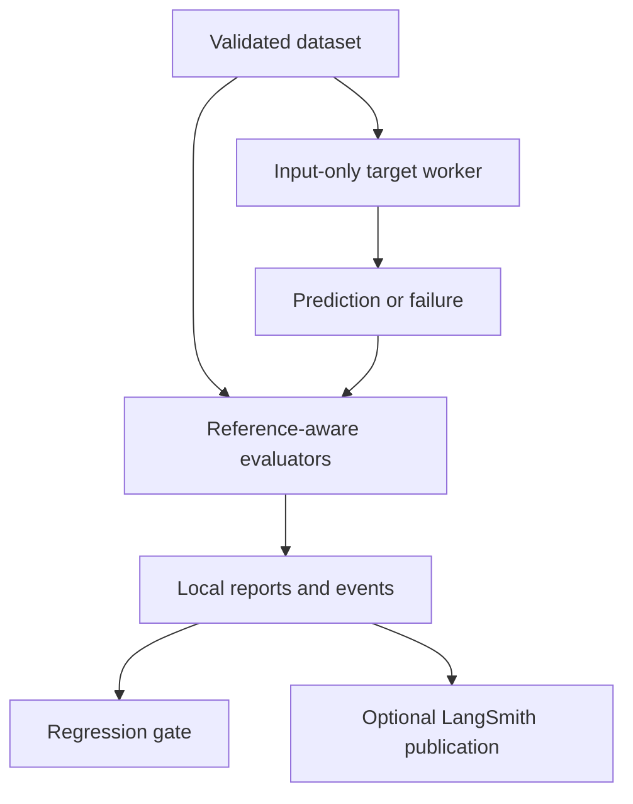

# Purpose, requirements and architecture

## Problem and intended user

Changing an LLM prompt, retrieval strategy or agent tool can silently break previous behaviour. This lab gives a backend or applied-AI engineer a reproducible way to measure those changes before release, inspect failures and share results. It is deliberately small enough to understand during an interview.

## Implemented requirements

| Requirement | Acceptance criterion |
| --- | --- |
| Dataset contracts | Reject malformed rows, duplicate case IDs, missing relevant sources and invalid reference definitions |
| Target isolation | Provide only input fields to the target; reference answers remain in the evaluator |
| Failure handling | Invalid outputs, crashes and deadline expiry become failing result records |
| RAG metrics | Score retrieval, citations, reference phrase coverage and lexical evidence support |
| Agent metrics | Check tool names, argument types/values, multiplicity, order and forbidden tools |
| Regression testing | Reject incomparable runs and detect per-case metric or latency deterioration |
| Latency | Distinguish target execution from worker wall time and evaluator duration |
| Reporting | Produce JSON, HTML, Markdown, JUnit XML and local events |
| Optional integrations | Support a structured-output Ollama judge and explicit LangSmith experiment publication |
| Reproducibility | Pin tested dependencies, fingerprint data/config, provide positive and negative fixtures and CI |

## Workflow

## Modules

| Module | Responsibility |
| --- | --- |
| `models.py` | Pydantic contracts and validation rules |
| `datasets.py` | JSONL loading, canonical JSON and fingerprints |
| `targets.py` | Deterministic good/flawed/crashing/slow demo targets |
| `runner.py` | Spawned target workers, hard deadline and case/repetition orchestration |
| `metrics.py` | Deterministic metrics and exact tool-trace matching |
| `judge.py` | Optional structured Ollama support assessment |
| `reporting.py` | Aggregation, report validation, safe HTML and JUnit generation |
| `regression.py` | Comparable-run requirements and per-case regressions |
| `langsmith_integration.py` | Explicit cloud dataset/recorded experiment upload |
| `cli.py` | CLI commands and quality/configuration exit codes |

## Decisions and trade-offs

The runner uses synchronous, serial evaluation and starts a new process per call. This makes deadlines and per-call state easy to reason about, but does not model a warm long-lived service. Target imports are outside `latency_ms` and inside `wall_ms`. Targets must not rely on previous local process state; call a running service through an adapter to measure a warm system.

Workers suppress stdout/stderr and retain only exception class names in reports. They are not security sandboxes, cannot prevent external side effects, and do not guarantee termination of target-spawned descendants. Only trusted adapters belong here.

Dataset fingerprints include references and source text. Evaluation fingerprints include thresholds, repetition count, deadline and judge configuration, but intentionally exclude target name. Reports with changed data/settings cannot be compared silently. Scorer-version changes require reviewed baseline updates. Hashes detect changes, not malicious tampering or provenance authenticity.

There is no model dependency in the default path. The deterministic demo emits text from retrieved synthetic documents and invokes simulated typed finance tools; this verifies the evaluation machinery, not a foundation model's intelligence. The optional judge is separately reported and fails closed on operational errors.

## Out of scope

Distributed load testing, production monitoring pipelines, cost/token accounting, external task side-effect rollback, semantic guarantees, universal agent adapters, automatic deployment decisions and comprehensive safety certification. Human review is still required before changing baselines or publishing private data.

## Primary references

- [LangSmith evaluation quickstart](https://docs.langchain.com/langsmith/evaluation-quickstart)
- [LangSmith evaluation types](https://docs.langchain.com/langsmith/evaluation-types)
- [LangSmith Python client reference](https://reference.langchain.com/python/langsmith/client/Client)
